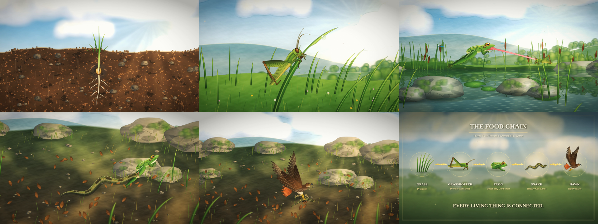
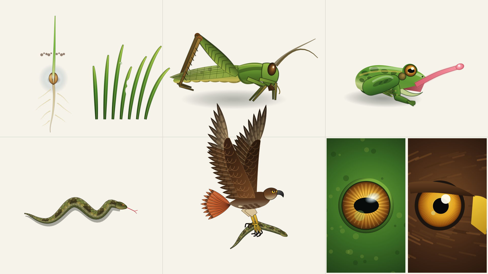

# PROJECT: THE FOOD CHAIN — A Cinematic 2-Minute Animated Nature Film in Python

A complete **1920×1080 @ 30 FPS** full-color animated wildlife short film (`food_chain_animation.mp4`, **2:04**) built entirely in Python, telling the story of energy flowing through a sunlit grassland ecosystem:

**GRASS → GRASSHOPPER → FROG → SNAKE → HAWK**



## Watch & Download

- **Direct Full-HD MP4 Download (1920×1080 @ 30 FPS, 53 MB, Stereo AAC):** [Download `food_chain_animation.mp4`](https://raw.githubusercontent.com/catalystberry842-alt/the-food-chain-120s/main/food_chain_animation.mp4)
- **GitHub File Page:** [`food_chain_animation.mp4`](https://github.com/catalystberry842-alt/the-food-chain-120s/blob/main/food_chain_animation.mp4)

### Individual Synchronized Scene Previews (720p @ 30 FPS)
1. **Scene 1 — Life Begins (`00:00–00:22`):** [`scene1_life_begins_preview.mp4`](previews/scene1_life_begins_preview.mp4)
2. **Scene 2 — The Grasshopper (`00:22–00:42`):** [`scene2_grasshopper_preview.mp4`](previews/scene2_grasshopper_preview.mp4)
3. **Scene 3 — The Frog Hunts (`00:42–01:02`):** [`scene3_frog_hunts_preview.mp4`](previews/scene3_frog_hunts_preview.mp4)
4. **Scene 4 — The Snake (`01:02–01:22`):** [`scene4_snake_preview.mp4`](previews/scene4_snake_preview.mp4)
5. **Scene 5 — The Hawk (`01:22–01:47`):** [`scene5_hawk_preview.mp4`](previews/scene5_hawk_preview.mp4)
6. **Scene 6 — The Complete Food Chain (`01:47–02:04`):** [`scene6_food_chain_preview.mp4`](previews/scene6_food_chain_preview.mp4)

---

## Visual & Audio Craftsmanship



- **Painterly Multi-Layer Environments (`environments.py`)**: Procedurally painted multi-layer ecosystems cached into `assets/` — stratified subterranean soil with pebbles & fine roots, golden early-morning skies with sculpted cumulus clouds, misty rolling hills & woodland belts, a reflective freshwater pond with wet mossy boulders & lily pads, a sun-dappled rocky clearing with fallen leaves, a sweeping valley sky panorama, and a luminous botanical finale backdrop.
- **Independent Articulated Character Systems (`characters.py`)**:
  - **Grass & Seed**: Germinating seed absorbing percolating water droplets, splitting its husk, growing branching downward taproot + root hairs, pushing shoots through soil clods, unfolding wind-swaying shaded blades with dewdrops, bending under weight, and losing real crescent bite notches as the grasshopper feeds.
  - **Grasshopper**: Hypognathous vertical-faced head, faceted bronze compound eye, animated mandibles & sensory palps, saddle pronotum, veined folded forewings, 7-segmented breathing abdomen, independently waving whip antennae, and 6 articulated legs with chevron-striated jumping hind femurs & spiny tibias.
  - **Green Pond Frog**: Streamlined emerald-olive skin with leopard spots, golden dorsolateral ridges, bronze tympanum, protruding metallic copper-gold eyes with nictitating membrane blink & authentic swallowing eye-retraction, pulsing vocal throat sac, smooth Z-folded/extending webbed hind legs, ballistic fleshy tongue strike, plus a macro eye close-up.
  - **Scaled Snake**: Continuous 58-segment lateral-undulation spine solver with poised S-coil gathering, rapid strike extension, non-graphic throat swallowing wave, hundreds of individually oriented diamond scales, grounded coil shadow, independent scaly head, and flicking forked crimson tongue.
  - **Red-tailed Hawk**: Articulated cambered wings with 7 fanned slotted primaries, 11 barred secondaries, scalloped chestnut coverts, spreadable 9-feather rufous tail, speckled belly-band, piercing golden eye with overhanging brow ridge, hooked slate beak, and yellow scaly talons that snatch & carry the snake, plus a dramatic raptor eye close-up.
- **Complete Synchronized Stereo Soundtrack (`narration.py`, `music.py`, `sound_engine.py`)**:
  - Natural BBC-documentary neural narration (`edge-tts`, `en-GB-RyanNeural`) with broadcast voice EQ.
  - Original 6-movement instrumental score synthesized via Karplus-Strong acoustic harp, felt piano, chorused bowed strings, airy wooden flute, French horn, timpani, and stereo concert-hall reverb.
  - Layered stereo wildlife soundscape (morning birdsong, dawn breeze, water droplets, soil rustle, leaf chewing, resonant formant frog croaks, pond water & splashes, dry leaves & slithering, snake hiss, piercing Red-tailed Hawk screech, wingbeats, diving wind, and golden energy chimes) mixed with automatic sidechain ducking.

---

## Project Structure

```text
food_chain_project/
├── main.py                  # CLI studio orchestrator (Stages 1–10)
├── animation.py             # Shared timeline, easing, splines, 2-bone IK & wind physics
├── camera.py                # Cinematic 2.5D virtual camera rig & parallax projection
├── drawing_engine.py        # PyCairo + NumPy + OpenCV + Pillow painterly rendering & grading
├── environments.py          # Multi-layer procedural painterly ecosystem asset generator
├── characters.py            # 5 independent anatomically realistic articulated character rigs
├── scenes.py                # Complete 6-scene cinematic choreography & transitions
├── narration.py             # Documentary neural TTS synthesis & timing alignment
├── music.py                 # Original 2-minute cinematic orchestral/acoustic film score
├── sound_engine.py          # Layered wildlife SFX, ambience & broadcast stereo masterer
├── renderer.py              # Parallel multiprocessing segmented Full-HD renderer & FFmpeg encoder
├── food_chain_animation.mp4 # Complete 1920x1080 @ 30 FPS Full-HD short film
├── assets/                  # Pre-baked painted environment plates & character sheet
├── audio/                   # Narration stems, original score, wildlife SFX & master WAV
└── previews/                # Individual synchronized scene preview MP4s & QA sheets
```

## Running the Pipeline Locally

```bash
pip install -r requirements.txt
python3 main.py --stage all
```

Or run individual production stages:

```bash
python3 main.py --stage assets    # Stage 1: Painted environments & character sheet
python3 main.py --stage qa        # Stages 2-7: 6-scene keyframe visual QA sheets
python3 main.py --stage audio     # Stage 8: Narration, original score & wildlife SFX
python3 main.py --stage previews  # Stage 9: Individual synchronized scene preview MP4s
python3 main.py --stage final     # Stage 10: Final 1920x1080 @ 30 FPS MP4 render
```
